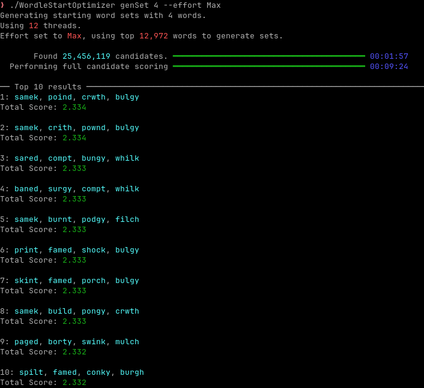
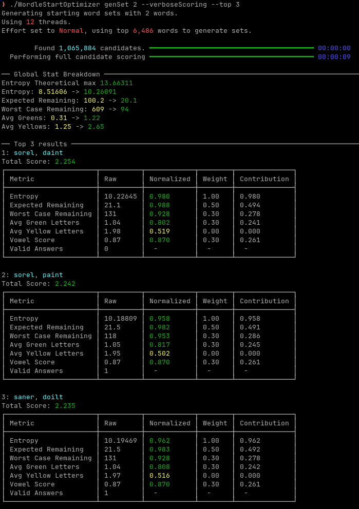
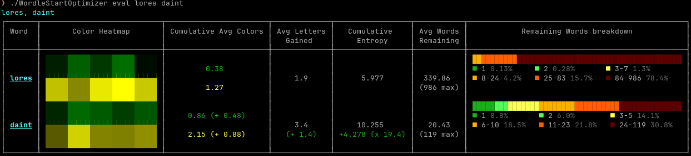

# Wordle Start Optimizer

I'm bad at wordle. So rather than getting better, I thought I'd use a skill I actually have to cheat and make the game easier (⌐■_■)

A command-line tool that searches for high-quality sets of Wordle opening words.

Rather than ranking individual words, Wordle Start Optimizer searches combinations of 2–5 words and scores them using a weighted combination of several metrics.

## Features

* Searches every valid combination of **1–5 starting words**
* Multi-threaded search for improved performance
* Configurable scoring weights
* Adjustable search effort to trade accuracy for speed
* Detailed scoring breakdowns
* Generate sets with required words
* Generate sets with required or blocked letters
* Generate sets that match specific letter patterns
* Duplicate letter policies
* Evaluate sets and get useful metrics on how it expected to perform

## Installation

Latest prebuilt executables can be found [here](https://github.com/Liamth99/WordleStartOptimizer/releases/tag/v2.3.3).

The executables are not self contained and you will need the [.NET 10 runtime](https://dotnet.microsoft.com/en-us/download/dotnet/10.0) 
installed (you do not need the SDK unless you plan on building it from source).

## How It Works

The program works in two stages.

### Candidate Generation

The program generates possible opening word combinations, by default sets cannot contain duplicate letters, but this can be overridden with `--duplicateLetterPolicy`.

| Policy              | Behaviour                                                  |
|---------------------|------------------------------------------------------------|
| Block (default)     | No letter may appear more than once across the whole set.  |
| BlockInSamePosition | Repeated letters are allowed, but not in the same position |
| Allow               | No restrictions                                            |

Allowing duplicates can dramatically increase the number of candidates generated, and an estimate will be displayed (this estimate assumes the policy is set to allow, 
and no restrictions or requirements are added). Currently the is a maximum of 2,147,483,647 candiates, this can be fixed in the future, however the scoring step is yet not 
optimized well enough for this to viable.

The search effort can be adjusted to reduce the amount of candidates generated, by only using the words with the highest entropy.

| Effort |       Candidates Scored |
|--------|------------------------:|
| Min    |                  Top 5% |
| Low    |                 Top 25% |
| Normal |                 Top 50% |
| High   |                 Top 75% |
| Max    |              Everything |

### Candidate Scoring

All the candidates are evaluated against the Wordle answer list.

For every possible answer, the program simulates playing the opening words and calculates the feedback patterns produced. These patterns are then used to measure how effectively the opening words reduce uncertainty making the game easier by reducing the number of possible remaining valid words.

Each metric is normalized between **0 and 1**, multiplied by its configured weight, and combined into a final score.

The default scoring model attempts to balance mathematical information gain with practical human play.

> note: this score is only meaningful in the run it is calculated for, you should not compare scores between different runs, instead use the raw stats which can be shown by using the `--verboseScoring` flag to compare sets from different runs.

### Entropy

Measures how evenly the opening set divides possible answers.

Higher entropy means the guesses produce more varied feedback patterns, giving more useful information. This is how most tools determine the "best" opening words.

Higher is better.

For more information I'd highly recommend watching [Solving Wordle using information theory | 3Blue1Brown](https://www.youtube.com/watch?v=v68zYyaEmEA).

---

### Expected Remaining

Measures the average number of possible answers remaining after the opening guesses.

Lower is better.

---

### Worst Case Remaining

Measures the largest possible answer group left after the least useful feedback pattern.

This prevents opening sets that are usually good but occasionally leave hundreds of possibilities.

Lower is better.

---

### Avg Green Letters

Rewards guesses that are likely to reveal correctly positioned letters.

Higher is better.

---

### Avg Yellow Letters

Rewards guesses that reveal correct letters in incorrect positions.

Disabled by default because other metrics already capture much of this information.

Also higher isn't necessarily better, as the higher the score, the more likely a set is to produce anagram.

---

### Vowel Coverage

Rewards sets containing a variety of vowels.

Not mathematically perfect, but humans tend to appreciate discovering that their mystery word contains actual vowels.

Higher is better.

## Usage

Run with:

```bash
WordleStartOptimizer genSet <setSize> [options]
```

Where `<setSize>` is between **2** and **5**.

---

Generate a 2-word opening set:

```bash
WordleStartOptimizer genSet 2
```

Perform the maximum search:

```bash
WordleStartOptimizer genSet 4 --effort Max
```



Show detailed scoring for top 3 results:

```bash
WordleStartOptimizer genSet 2 --verboseScoring --top 3
```



Generate an opening set that promotes anagrams:

```bash
WordleStartOptimizer genSet 4 -y 1.0 -g -0.3 -e 0.5
```

Generate a 3 word set with the words Adieu and Torch

```bash
WordleStartOptimizer genSet 3 --requiredWords "adieu torch"
```

Generate a 3 word set with some really terrible letters

```bash
WordleStartOptimizer genSet 3 --requiredLetters zxqj
```

Generate a word with no vowels

```bash
WordleStartOptimizer genSet 1 --blockedLetters aeiouy
```

Generate a set that matches a pattern

```bash
WordleStartOptimizer genSet 2 --wordPattern sh***
```

> will generate sets like `sorel, ahint`

### Evaluating a Set

```bash
WordleStartOptimizer eval [<word> ...]
```

Takes a specific set of words and reports its metrics.

Evaluate a 2-word set:

```bash
WordleStartOptimizer eval lores daint
```



###### AI disclaimer: I used AI to assist with documentation, licensing and the `PatternCounter` class (because idk how to make performant collection types).
